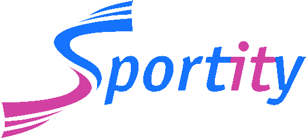

🇳🇱 **Nederlands** · 🇩🇪 [Deutsch](readmeGER.md) · 🇬🇧 [English](readmeEN.md)

<p align="center">
  
</p>

<h1 align="center">Sportity voor Windows</h1>

<p align="center">
  <b>Alle rallydocumenten van Sportity overzichtelijk op je pc — automatisch bijgewerkt en altijd offline beschikbaar.</b>
</p>

<p align="center">
  <a href="https://github.com/ITMarco/SportityGui/releases/latest"><b>⬇️ Download de nieuwste versie</b></a>
  &nbsp;·&nbsp;
  <a href="http://www.shoarmateam.nl/rally/SportityGui/SportityGui-current.zip">Alternatieve download (zip)</a>
</p>

---

## 🎬 Zie het in actie

https://github.com/user-attachments/assets/8d3a0e05-ef58-494f-ac36-ca6c366efc12

---

## Waarom SportityGui?

Bij elke rally verschijnen er via [Sportity](https://webapp.sportity.com) voortdurend nieuwe documenten: bulletins, tijdschema's, startlijsten, uitslagen, mededelingen van de wedstrijdleiding. Steeds de website verversen om te zien of er iets nieuws is? Dat hoeft niet meer.

**SportityGui doet het werk voor je:**

- ✅ **Ziet direct wat nieuw is** — nieuwe documenten krijgen een duidelijk **NEW**-label
- ✅ **Ververst automatisch** — op de achtergrond, zo vaak als jij wilt
- ✅ **Downloadt alles automatisch** — netjes gesorteerd per kanaal en evenement
- ✅ **Werkt ook zonder internet** — handig in het servicepark of op een afgelegen proef
- ✅ **Meldt zich vanzelf** — een Windows-melding zodra er nieuwe bestanden of evenementen zijn
- ✅ **Meerdere kanalen tegelijk** — volg alle rally's die jou interesseren in één venster

Ideaal voor rijders, navigators, teams, officials en iedereen die de rallysport op de voet volgt.

---

## 🚀 In 3 stappen aan de slag

1. **Download** de nieuwste versie via de [Releases-pagina](https://github.com/ITMarco/SportityGui/releases/latest) (of de [zip](http://www.shoarmateam.nl/rally/SportityGui/SportityGui-current.zip)).
2. **Start** `SportityGui.exe`. Installeren is niet nodig, en .NET hoef je ook niet apart te installeren. Bij de eerste start kies je een map waar de documenten worden opgeslagen.
   > 💡 Toont Windows een blauw venster ("Windows heeft uw pc beschermd")? Klik dan op **Meer info** → **Toch uitvoeren**.
3. **Plak** een Sportity-link in de invoerbalk — of typ alleen de **kanaalcode** (bijvoorbeeld `ELE`) — en druk op Enter. Klaar!

Je kanalen worden onthouden en bij de volgende start automatisch opnieuw geladen.

---

## ✨ Wat kun je ermee?

### Kanalen en evenementen
- Plak een willekeurige Sportity-link van een **kanaal** of **evenement**; de app herkent zelf wat het is
- Typ alleen een **kanaalcode** (bijv. `ELE`) en de app zoekt de juiste pagina erbij
- Volg **meerdere kanalen tegelijk** in het linkerpaneel, elk in- en uitklapbaar
- Bepaal zelf de volgorde door kanalen te **verslepen**

### Documenten bekijken
- Overzichtelijke boomstructuur met mappen, bestanden en berichten
- **NEW**-labels laten precies zien wat je nog niet gezien hebt — ook op mapniveau
- **Eén keer klikken** toont de details van een bestand
- **Dubbelklikken** downloadt het bestand (indien nodig) en opent het direct
- **Zoekveld** om snel het juiste document te vinden

### Downloaden
- **Automatisch downloaden** van alle bestanden bij het laden van een evenement
- Of zelf kiezen: rechtsklik op een map → *Download all documents*
- Bestanden worden netjes opgeslagen als `Downloadmap \ Kanaalcode \ Evenementnaam \`
- Een **eigen downloadmap per kanaal of evenement** instellen (rechtsklik → *Set download folder…*)
- Wijzig je de downloadmap, dan biedt de app aan om **bestaande downloads mee te verhuizen**

### Automatisch verversen en meldingen
- Stel per kanaal of evenement in hoe vaak er gecontroleerd wordt (`[− N min +]` in de werkbalk)
- Een aftelklok in de statusbalk laat zien wanneer de volgende controle is
- **Windows-meldingen** bij nieuwe bestanden of nieuwe evenementen

### Systeemvak
- **Minimaliseren naar het systeemvak** — de app blijft stilletjes op de achtergrond meekijken
- Start eventueel direct geminimaliseerd met `--minimized`
- Start je de app per ongeluk nog een keer? Dan komt gewoon het bestaande venster naar voren

### Instellingen en updates
- **Licht, donker** of het Windows-thema volgen
- De app **controleert zelf op updates**, downloadt ze en installeert ze met één klik — je instellingen blijven behouden

---

## ❓ Veelgestelde vragen

**Kost het iets?**
Nee. SportityGui is gratis en open source (GPL-3.0-licentie).

**Heb ik een Sportity-account nodig?**
Nee. De app leest dezelfde openbare pagina's die je ook in de browser op [webapp.sportity.com](https://webapp.sportity.com) ziet.

**Waar vind ik de kanaalcode of link?**
Open het kanaal of evenement op [webapp.sportity.com](https://webapp.sportity.com) en kopieer de link uit de adresbalk van je browser. Plak die in SportityGui.

**Hoe begin ik helemaal opnieuw?**
Verwijder `state.json` naast het `.exe`-bestand. Je kanalen en de gelezen/ongelezen-status worden dan gewist; je instellingen blijven bewaard.

**Is de app zelf ook in het Nederlands?**
De menu's van de app zijn in het Engels, maar alles werkt met een paar klikken en spreekt voor zich — kijk de video hierboven maar.

**Is dit een officiële app van Sportity?**
Nee, SportityGui is een onafhankelijk hulpmiddel gemaakt door een rallyliefhebber.

---

## 🛠️ Voor ontwikkelaars

Technische details — tech stack, bouwen, publiceren en databestanden — vind je in de [Engelstalige README](readmeEN.md).

```
dotnet build src/SportityGui/SportityGui.csproj
```

---

<p align="center">Gemaakt met ❤️ voor de rallysport · <a href="LICENSE">GPL-3.0</a></p>
