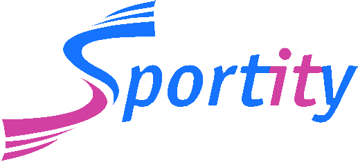

🇳🇱 [Nederlands](README.md) · 🇩🇪 **Deutsch** · 🇬🇧 [English](readmeEN.md)

<p align="center">
  
</p>

<h1 align="center">Sportity für Windows</h1>

<p align="center">
  <b>Alle Rallye-Dokumente von Sportity übersichtlich auf deinem PC — automatisch aktualisiert und jederzeit offline verfügbar.</b>
</p>

<p align="center">
  <a href="https://github.com/ITMarco/SportityGui/releases/latest"><b>⬇️ Neueste Version herunterladen</b></a>
  &nbsp;·&nbsp;
  <a href="http://www.shoarmateam.nl/rally/SportityGui/SportityGui-current.zip">Alternativer Download (ZIP)</a>
</p>

---

## 🎬 So sieht es aus

https://github.com/user-attachments/assets/8d3a0e05-ef58-494f-ac36-ca6c366efc12

---

## Warum SportityGui?

Bei jeder Rallye erscheinen über [Sportity](https://webapp.sportity.com) ständig neue Dokumente: Bulletins, Zeitpläne, Startlisten, Ergebnisse, Mitteilungen der Rallyeleitung. Immer wieder die Webseite neu laden, um nichts zu verpassen? Das ist vorbei.

**SportityGui übernimmt das für dich:**

- ✅ **Zeigt sofort, was neu ist** — neue Dokumente erhalten ein deutliches **NEW**-Label
- ✅ **Aktualisiert automatisch** — im Hintergrund, so oft du willst
- ✅ **Lädt alles automatisch herunter** — sauber sortiert nach Kanal und Veranstaltung
- ✅ **Funktioniert auch ohne Internet** — praktisch im Service-Park oder an einer abgelegenen Wertungsprüfung
- ✅ **Meldet sich von selbst** — Windows-Benachrichtigung, sobald neue Dateien oder Veranstaltungen da sind
- ✅ **Mehrere Kanäle gleichzeitig** — verfolge alle Rallyes, die dich interessieren, in einem Fenster

Ideal für Fahrer, Beifahrer, Teams, Offizielle und alle, die den Rallyesport hautnah verfolgen.

---

## 🚀 In 3 Schritten startklar

1. **Herunterladen**: neueste Version über die [Releases-Seite](https://github.com/ITMarco/SportityGui/releases/latest) (oder als [ZIP](http://www.shoarmateam.nl/rally/SportityGui/SportityGui-current.zip)).
2. **Starten**: `SportityGui.exe` öffnen. Keine Installation nötig, auch .NET musst du nicht separat installieren. Beim ersten Start wählst du einen Ordner, in dem die Dokumente gespeichert werden.
   > 💡 Erscheint ein blaues Fenster („Der Computer wurde durch Windows geschützt“)? Klicke auf **Weitere Informationen** → **Trotzdem ausführen**.
3. **Einfügen**: einen Sportity-Link in die Eingabeleiste einfügen — oder nur den **Kanalcode** eintippen (zum Beispiel `ELE`) — und Enter drücken. Fertig!

Deine Kanäle werden gespeichert und beim nächsten Start automatisch neu geladen.

---

## ✨ Was kann die App?

### Kanäle und Veranstaltungen
- Beliebigen Sportity-Link eines **Kanals** oder einer **Veranstaltung** einfügen; die App erkennt selbst, worum es sich handelt
- Nur einen **Kanalcode** eingeben (z. B. `ELE`) und die App findet die passende Seite
- **Mehrere Kanäle gleichzeitig** im linken Bereich verfolgen, jeweils ein- und ausklappbar
- Reihenfolge per **Drag & Drop** selbst festlegen

### Dokumente ansehen
- Übersichtliche Baumstruktur mit Ordnern, Dateien und Nachrichten
- **NEW**-Labels zeigen genau, was du noch nicht gesehen hast — auch auf Ordnerebene
- **Einfacher Klick** zeigt die Details einer Datei
- **Doppelklick** lädt die Datei (falls nötig) herunter und öffnet sie direkt
- **Suchfeld**, um schnell das richtige Dokument zu finden

### Herunterladen
- **Automatischer Download** aller Dateien beim Laden einer Veranstaltung
- Oder selbst entscheiden: Rechtsklick auf einen Ordner → *Download all documents*
- Dateien werden ordentlich abgelegt unter `Downloadordner \ Kanalcode \ Veranstaltungsname \`
- **Eigener Downloadordner pro Kanal oder Veranstaltung** (Rechtsklick → *Set download folder…*)
- Änderst du den Downloadordner, bietet die App an, **bereits heruntergeladene Dateien mitzuverschieben**

### Automatische Aktualisierung und Benachrichtigungen
- Pro Kanal oder Veranstaltung einstellen, wie oft geprüft wird (`[− N min +]` in der Symbolleiste)
- Ein Countdown in der Statusleiste zeigt, wann die nächste Prüfung erfolgt
- **Windows-Benachrichtigungen** bei neuen Dateien oder neuen Veranstaltungen

### Infobereich (System Tray)
- **In den Infobereich minimieren** — die App läuft unauffällig im Hintergrund weiter
- Optional direkt minimiert starten mit `--minimized`
- App versehentlich nochmal gestartet? Dann wird einfach das vorhandene Fenster nach vorne geholt

### Einstellungen und Updates
- **Hell, dunkel** oder dem Windows-Design folgen
- Die App **sucht selbst nach Updates**, lädt sie herunter und installiert sie mit einem Klick — deine Einstellungen bleiben erhalten

---

## ❓ Häufige Fragen

**Kostet die App etwas?**
Nein. SportityGui ist kostenlos und Open Source (GPL-3.0-Lizenz).

**Brauche ich ein Sportity-Konto?**
Nein. Die App liest dieselben öffentlichen Seiten, die du auch im Browser unter [webapp.sportity.com](https://webapp.sportity.com) siehst.

**Wo finde ich den Kanalcode oder Link?**
Öffne den Kanal oder die Veranstaltung auf [webapp.sportity.com](https://webapp.sportity.com) und kopiere den Link aus der Adressleiste deines Browsers. Füge ihn in SportityGui ein.

**Ist die App selbst auch auf Deutsch?**
Die Menüs der App sind auf Englisch, aber alles funktioniert mit wenigen Klicks und erklärt sich von selbst — schau dir einfach das Video oben an.

**Wie fange ich ganz von vorne an?**
Lösche die Datei `state.json` neben der `.exe`. Deine Kanäle und der Gelesen/Ungelesen-Status werden dann zurückgesetzt; deine Einstellungen bleiben erhalten.

**Ist das eine offizielle App von Sportity?**
Nein, SportityGui ist ein unabhängiges Werkzeug, entwickelt von einem Rallye-Fan.

---

## 🛠️ Für Entwickler

Technische Details — Tech-Stack, Build, Veröffentlichung und Datendateien — findest du in der [englischen README](readmeEN.md).

```
dotnet build src/SportityGui/SportityGui.csproj
```

---

<p align="center">Mit ❤️ für den Rallyesport gemacht · <a href="LICENSE">GPL-3.0</a></p>
